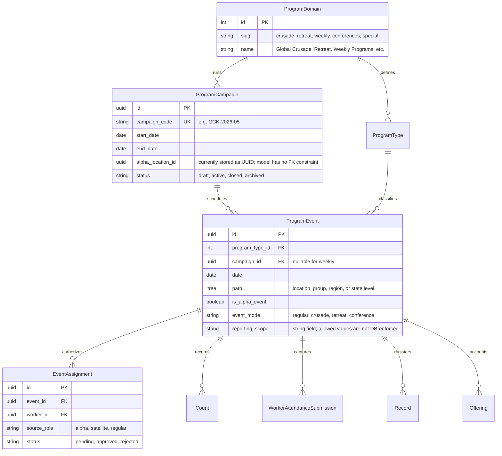
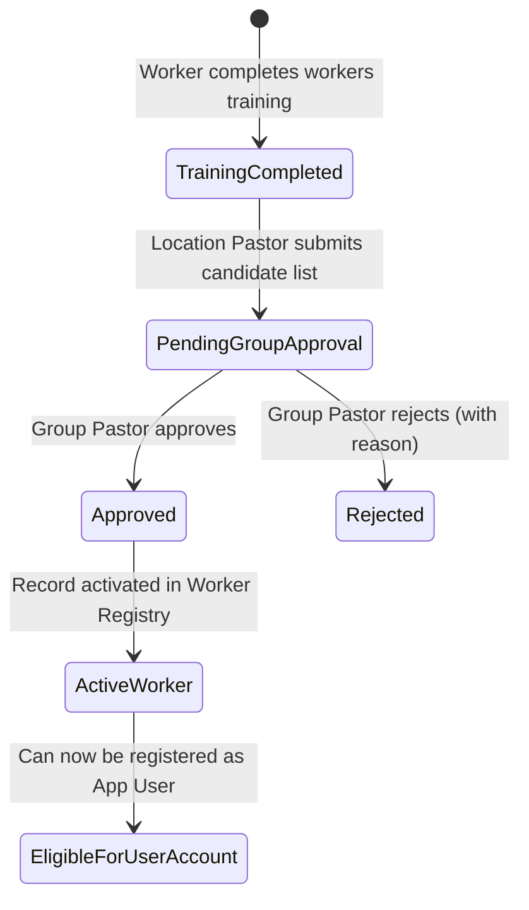
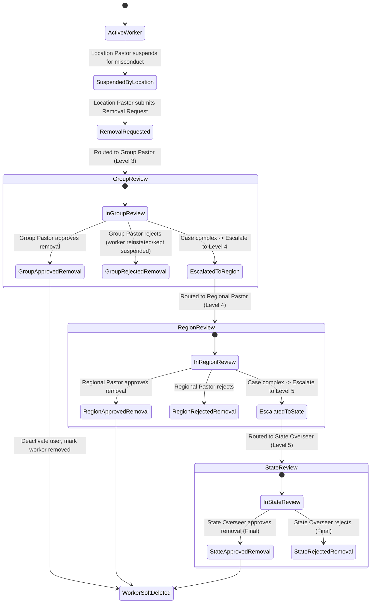
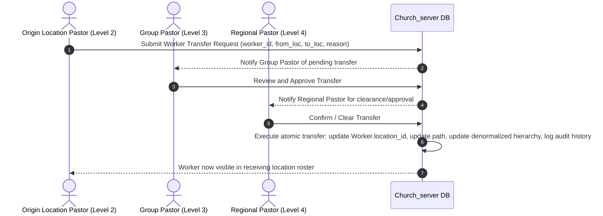
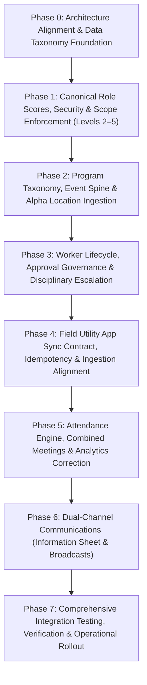

# DCLM Church Management System (Levels 2–5)
# Comprehensive System Architecture, Gap Analysis & Phase-by-Phase Implementation Fix Plan

**Document File:** `IMPLEMENTATION_FIX_PLAN.md`
**System Target:** `Church_server` (Administrative & Governance Backend for Pastoral Levels 2–5)
**Client Ecosystem:**
- **Field Utility App:** Principal mobile client for Level 1 workers/ushers (data collection, population counting, worker attendance, house fellowship records, newcomer/convert intake, worker registrations).
- **Admin Management Console / Server:** Leadership oversight, approval workflows, communication dissemination, and hierarchical analytics for Location Pastors (Level 2), Group Pastors (Level 3), Regional Pastors (Level 4), and State Overseers (Level 5).
- **Higher-Level Client:** Levels 6–9 will be presented through a separate client when needed; their roles, authority, and jurisdiction remain supported by the shared backend.

---

> **Evidence convention:** The role rules, program patterns, and workflows in Section 1 describe the operating requirements supplied by the church owner. They are not claims that the current software already implements them. Sections marked as current-code observations are grounded in repository models, schemas, routes, and Field Utility source. Recommendations and proposed schemas describe future work. Development or local verification must not be presented as production verification.


## 0. Implementation Status and Shared-Backend Boundary (2026-11-04)

This plan targets the **levels 2–5 administrative client**. The backend is shared with separate clients and must continue to recognize levels 1 and 6–9. A client boundary is not a backend authority boundary:

- Scores follow the user's canonical hierarchy: 1 worker/usher, 2 location pastor, 3 group pastor, 4 regional pastor, 5 state pastor, 6 zonal coordinator, 7 national overseer, 8 continental/general administrator, 9 super-administrator/superintendent.
- Scores increase with authority. Levels 6–9 retain higher-tier operational permissions on the shared backend. Score 9 is global. Score 8's available scope is derived from the existing `Nation.continent` mapping. Level 6's zone-to-path mapping is not established in the current schema, so its role grants can be preserved but zone-wide data access must fail closed until that mapping exists.
- The levels 2–5 admin UI and its generic role-assignment workflow must not grant levels 6–9 roles. Higher-tier roles must retain backend authentication, hierarchy scope, and permissions for their separate client.
- The Field Utility is the level 1 client. Special event data access should be authorized by a worker's approved event assignment, then enforced at the relevant submission endpoints.
- Program metadata level (location/group/region/state meeting scope) is distinct from role score; neither should be inferred from the other.

### Jurisdiction-managed program scheduling workflow (implemented; acceptance open)

- A schedule is created by a user with the explicit `programs:create_event` permission, assigned to the relevant level admin and pastor roles for their own jurisdiction. An admin-created event is pending until the pastor at that same level approves or rejects it. A pastor-created event is approved immediately and records that pastor as creator and approver. No higher-level approval step is required. A user cannot approve their own still-pending event.
- A schedule targets either a canonical program domain or a canonical program type within that domain. Domain/type membership must be validated from the taxonomy; client-supplied labels alone are not authorization.
- The organizer sets the reporting scope, date/time window, and the workers allowed to collect data. Once assigned users sign in, the Utility should offer or apply the active assignment's setup automatically (program, reporting level, date/window, and reporting scope) so each worker does not configure it manually. Workers may not widen or edit the assignment's authorized scope.
- Schedule access expires automatically at its end time. An authorized organizer may close or cancel it earlier. Expired/closed schedules reject new submissions while retaining prior submissions and audit history.
- Schedules are optional for routine services. An unscheduled capture can use the existing authorized local workflow; a broader combined capture requires an explicit, server-validated authority/assignment path. A schedule for one combined service must not block other locations' unrelated reporting.
- Crusades retain the specialized Alpha Location and Satellite source roles. Conferences, retreats, and other centrally coordinated programs may use schedules when assignment and collection windows are needed.
- Keep the reporting jurisdiction separate from the physical collection location. The former determines aggregation and authorization; the latter identifies the venue/source location. Never place a Group/Region/State code in a physical `location_id` UUID field.
- Development implementation is present in `ProgramEvent` and `EventAssignment`: approval state and audit identity, same-level pastor approval, permission-checked jurisdiction event creation, active assignment lookup, and Utility setup on sign-in. Hosted/browser acceptance remains open; current code and local database state do not establish production rollout.

### Jurisdiction-scoped permission delegation (next RBAC capability; not implemented)

- Keep the shared `Role`/`Permission` catalog as stable, migration-managed defaults. Do not let a level pastor edit a shared role definition because that changes access for users with the same role across other jurisdictions.
- Add a separate pastor-only **Local Permissions** workspace. It should grant or revoke a specific, allowlisted capability for an individual user within the pastor's own jurisdiction, while the existing RBAC Studio remains the catalog/role visibility surface.
- Resolve effective access as role defaults plus active, scoped user grants, minus explicit scoped revocations. Every request must validate the target user is inside the pastor's hierarchy path and the permission is in that level's delegable allowlist; a grant must never exceed the pastor's own permission set or cross jurisdiction boundaries.
- Make grants auditable and reviewable: permission, target user, jurisdiction path, grant/revoke actor, reason, timestamps, and optional expiry. High-impact capabilities such as approvals, worker removal, role assignment, or access management should use explicit workflows and, where policy requires, another reviewer rather than an unrestricted toggle.
- Preserve the agreed worker-removal chain and other action-specific approval flows. A pastor's broad same-level authority does not turn a request, suspension, or escalation into an untracked hard delete.

### Verified implementation progress

- **Development database baseline:** revision `aa71b5c49d20` matched the pre-change code head. A restorable public-schema dump was verified before migration.
- **Applied development migrations:** `0d8f6a2b4c91` canonicalized score bindings and RLS write rules; `1c7d4e9a2f60` normalized seeded score 7–9 user/worker home paths; `6a9c2e1f4b70` removed direct worker-delete permission from score 2; `92b7e4c1d630` added program level to program report tables; `4e68a01bd527` canonicalized program domains/types and added their foreign keys; `a4c29e81b705` added `program_scope_path`; `b1342f6a7c91` added worker lifecycle review stages and removal restoration snapshots; `c2138e4a6f90` moved legacy origin-approved transfers into the receiving-review stages; `d9e3a70c18f4` added worker-candidate client idempotency; and `e1f4c0b72a91` records the user who submitted a worker registration. Additional Phase 5/6 migrations are listed in those phase sections. Revision `f5a7c9e1d3b2` adds GiST expression indexes for hierarchy paths and program reporting paths. The development database currently reports head `f5a7c9e1d3b2` (verified with `alembic current` on 2026-11-05).
- **Implemented and checked:** canonical level 1–9 role mapping; level 2–5 location/group/region/state path mapping; level 7 nation path; level 8 continent-filtered scope via `Nation.continent`; score 9 global scope; levels 6–8 retain higher-tier operational permission grants and score 9 retains all current permission grants; RBAC catalog writes stay score 9 and release writes score 5+; the levels 2–5 client filters role assignment to its own tiers while the shared backend supports the higher score hierarchy; approved-worker prerequisite and Group Pastor registration approval; score 2 removal request and audited suspension; score 3+ direct worker removal.
- **Phase 1 status:** **implementation phase closed** for the agreed 1–9 score hierarchy and levels 2–5 admin scope. Scores 6–9 retain higher-level backend authority; the levels 2–5 client excludes higher-tier role assignment. The full backend suite passed (140 tests in the latest recorded run); focused scope and event-assignment tests passed again (43 tests). Zone-wide score 6 scoping still fails closed until a zone-to-path model exists. A production authorization certification is not claimed; the wider endpoint acceptance matrix belongs in Phase 7.
- **Phase 2 status:** **implementation phase closed; schema and single-flow development acceptance verified.** The three migrations through `a4c29e81b705` are applied. New program submissions resolve canonical domain/type IDs, carry explicit program level and `program_scope_path`, preserve physical `location_id` and authorization `path`, and use the authenticated actor. Field Utility queue serialization/proxy validation and the backend are aligned. A signed-in Utility browser submission was verified against the local updated backend and development Supabase: the stored row had `program_level=Local`, canonical Weekly/Monday Bible Study IDs, and the expected location scope path. The synthetic test rows were soft-deleted; active count total returned to its prior value. Fellowship records remain outside this metadata spine. Historical rows keep program level null where it was never captured; no values were guessed. The automated Alpha/Satellite authorization helper tests pass. Full multi-day Crusade campaign/Alpha/Satellite reporting acceptance remains scheduled for Phase 7 integration verification, rather than being represented as completed here.
- **Hosted-dev deployment note:** the first browser submission reached the hosted API configured in the Utility environment and returned success, but its stored row lacked the new metadata. Repointing the local Utility process to the updated local backend made the same flow persist all required fields. The hosted dev API therefore has not yet been verified against this code; deploy the updated backend there before hosted-client acceptance. This does not change the applied database migration head.
- **Phase 3 implementation status (2026-11-04):** candidate approval, discipline/removal review, and worker transfer governance are implemented. Migrations `b1342f6a7c91` and `c2138e4a6f90` are applied to the configured development database and the current automated suite passes. The user-account and hierarchy changes are enforced through the updated routes; reviewer-persona end-to-end verification remains open. The transfer chain now explicitly requires Origin Group Pastor -> Receiving Location Pastor -> Receiving Group Pastor -> Regional Pastor (or State Overseer at the regional decision stage) before the worker and linked user scope move.
- **Phase 4 status (updated 2026-11-05):** **Implementation and worker-candidate acceptance are complete locally; full Field Utility data-entry acceptance remains open.** Aggregate attendance sync recovers concurrent `client_id` uniqueness races as scoped duplicates, and conflict audit includes aggregate attendance. Worker-candidate intake, stable idempotency, authenticated submitter provenance, pending verification, Group Pastor approval, and the previously recorded 50-item/mixed-batch checks are implemented. The locally running Utility also accepted synthetic population, offering, convert, and worker-attendance submissions. A 390px browser check was used for the setup UI. Fellowship entry was not submitted because no fellowship was available under the test user's location. This is a missing test fixture, not a need for a separate fellowship user: the existing Level 1 user at a location should submit fellowship reports for fellowships belonging to that location. The hosted development endpoint is still not verified against the current code. Do not claim Phase 4 release/hosted readiness.
  - **Live local verification:** an authenticated Utility submit returned one pending candidate; replaying its client ID returned the same worker as a duplicate; a Group Pastor approved it. A 50-candidate batch returned 50 synced and its identical replay returned 50 duplicates with zero errors. A mixed batch returned two synced valid candidates and one duplicate-phone error; replay reported the two canonical rows as duplicates and preserved the specific conflict message. All synthetic records from these checks were soft-deleted and confirmed absent from active/search results.
  - **Checks:** backend `pytest -q` passed (145 tests); Field Utility `pytest -q` passed (26 tests); JavaScript syntax, Python compile, and `git diff --check` passed. Development DB head is `e1f4c0b72a91`.
  - **Release boundary:** verification used the isolated local Utility and local backend pointed at the development database. The separate hosted development endpoint configured in `utility_app/.env` was not updated or verified against these changes. Deploy and run the same client/backend acceptance there before calling that endpoint ready; no production verification is claimed.
- **Phase 5 status (2026-11-05):** **Implementation and local development acceptance closed.** Verified event creation by Group Admin with Group Pastor approval, active assignment and approval, the assigned-session roster and automatic Utility setup, and an actual combined Group Leaders Meeting attendance capture from the Utility through sync to the updated local backend. The backend persisted the aggregate submission and linked present-worker row; the queue cleared and local sync history recorded `synced`. The sync test found and fixed a PostgreSQL mismatch: `program_scope_path` is persisted as text, while the custom `LtreeType` comparison bound equality parameters as `LTREE`; exact reporting-path equality now casts the column to `VARCHAR`. Synthetic event, assignment, attendance submission/row, and schedule rows were soft-deleted and verified; the attendance event fixture had two same-title rows, both cleaned up.
- **Phase 6 status (2026-11-05):** **Implementation and local development acceptance closed.** A Region Pastor published a synthetic structured information sheet; the Group Pastor retrieved it through the authenticated latest-information API, and the Utility Information screen rendered the published content. A State Overseer broadcast to a target Group with `pastors` audience; the Group Pastor saw the message in notification history, the scoped listing reported four recipients, and a worker persona was excluded. The synthetic sheet and broadcast were deactivated after verification. Delivery is in-app/dynamic; external push/SMS has not been implemented.
- **Additional Phase 7 checks (2026-11-05):** On the current-source backend (8012), workers, attendance submissions, fellowship lists, counts, and event lists returned 200 for the seeded Location/Group/Region/State personas; returned records stayed within scope. Event lists also included ancestor schedule paths by design; no sibling paths appeared. The dashboard bootstrap scope matrix was re-run on current-source 8012: all 17 default, own-scope, allowed-descendant, sibling-denial, and out-of-state cases passed (expected 200/403). The original 8010 process is stale relative to the current checkout: its counts list returned 500 because its response validation still treats eventless legacy rows as requiring create-time metadata. The same query on current-source 8012 returned 200; restart/redeploy the original process before treating its runtime as current.
- **Verification checks:** `python -m pytest -q` passed (181 tests in the latest full run, one dependency deprecation warning); `python -m compileall -q app tests` passed; `git diff --check` returned no whitespace errors (Git printed existing LF/CRLF normalization warnings). Browser verification used isolated local services pointed at the development database. Synthetic Phase 5/6 fixtures were cleaned up and their soft-delete/deactivation states read back from the database.
- **Phase 7 local dashboard status (2026-11-05):** Level 2–5 dashboards load population analytics by default. The default recent period is the last 30 days; users can select month-to-date, quarter-to-date, or year-to-date. These filters apply to population averages and child-scope comparison only; the surrounding member/worker/governance cards remain scope-wide. State, Region, and Group views expose only their immediate authorized child scopes, and selecting a child reloads the full dashboard at that scope. The API enforces the user's allowed hierarchy even if a scope path is edited manually. A live State Overseer browser session verified State → Region → Group drill-down, month selection, changed scoped worker totals, and zero browser console errors; the corresponding bootstrap requests returned 200. The browser run also exposed and fixed two defects: hierarchy tables do not implement `is_deleted`, so direct-child queries now rely on scoped ltree paths and exact child depth; and dashboard URL context can repeat `scope_path`, so the last selected value is honored. Church statistics now return a date-only value for a datetime-backed record, preventing a response-validation 500 observed with development data. Period-start unit tests cover all four windows.
- **Fellowship closeout checks:** Source RBAC assigned `hierarchy:create_fellowship` to Region/State roles and `hierarchy:delete_fellowship` to State roles, but the development database lacked those grants. Migrations `f6b8d2a4c910` and `f7c2d4a6b810` restore the persisted grants without running the full RBAC seeder (which replaces default role permission sets and could erase custom grants). After a targeted pre-migration snapshot, a Region Pastor created an in-scope temporary fellowship. A Location Worker signed into Utility, selected it, and successfully synced an attendance report, member, and offering; all three batch responses reported `created` with zero errors. A State Overseer soft-deleted all three activity rows and removed the test fellowship; subsequent reads returned 404 and the active list no longer contained the fixture. Thus no test fellowship records remain active.
- **Additional Phase 7 checks (2026-11-05):** On the current-source backend (8012), workers, attendance submissions, fellowship lists, counts, and event lists returned 200 for the seeded Location/Group/Region/State personas; returned records stayed within scope. Event lists also included ancestor schedule paths by design; no sibling paths appeared. The dashboard bootstrap scope matrix was re-run on current-source 8012: all 17 default, own-scope, allowed-descendant, sibling-denial, and out-of-state cases passed (expected 200/403). The original 8010 process is stale relative to the current checkout: its counts list returned 500 because its response validation still treats eventless legacy rows as requiring create-time metadata. The same query on current-source 8012 returned 200; restart/redeploy the original process before treating its runtime as current.
- **Fellowship closeout checks:** Source RBAC assigned `hierarchy:create_fellowship` to Region/State roles and `hierarchy:delete_fellowship` to State roles, but the development database lacked those grants. Migrations `f6b8d2a4c910` and `f7c2d4a6b810` restore the persisted grants without running the full RBAC seeder (which replaces default role permission sets and could erase custom grants). After a targeted pre-migration snapshot, a Region Pastor created an in-scope temporary fellowship. A Location Worker signed into Utility, selected it, and successfully synced an attendance report, member, and offering; all three batch responses reported `created` with zero errors. A State Overseer soft-deleted all three activity rows and removed the test fellowship; subsequent reads returned 404 and the active list no longer contained the fixture. Thus no test fellowship records remain active.
- **FastStrap browser check:** The installed Utility virtualenv contained a malformed FastStrap 0.10.1 initializer, while the checked-in framework source and a freshly downloaded official `faststrap==0.10.1` wheel contained the corrected `evt.data ?? ''`. Reinstalled that exact wheel into the Utility virtualenv (no project dependency change). `node --check` passed for the installed initializer; the Location Worker browser flow then reported zero console errors.
- **Current work:** Phase 7 local implementation and the dashboard/fellowship integration checks described above are complete. Phase 7 rollout acceptance remains open: complete action-by-action Location/Group/Region/State workflows; exhaustive endpoint-by-endpoint cross-jurisdiction checks beyond the sampled scope matrix; multi-event Alpha/Satellite campaign and reporting comparison; restore drill; hosted development deployment/client acceptance; phone-browser acceptance; production readiness review. Hosted and production operation are not certified.

## 0.1 Evidence and Scope Corrections

The code uses `location_id` as a location UUID/FK in several capture payloads; it must not be used to represent a group/region/state meeting scope. `program_event.level`, role score, and record hierarchy path are separate fields/concepts. Fellowship activity remains location/fellowship scoped and does not require the shared program domain/type spine. Existing live rows with nullable `event_id` must be handled as legacy data and not silently treated as complete metadata.

---
## 1. Executive Summary & Intent Alignment

### 1.1 The Church's Real Operating Reality
The Deeper Christian Life Ministry (DCLM) operates through a defined leadership hierarchy and program structure. The system should reflect the church's stated workflows and terminology:

1. **Four Pastoral Governance Tiers (Levels 2–5):**
   - **Level 2 — Location Pastor:** Shepherds the local assembly. Controls local activities, initiates worker transfers to his branch, marks or oversees attendance, and suspends workers for misconduct while submitting formal removal requests to the Group Pastor.
   - **Level 3 — Group Pastor:** Oversees a cluster of church locations. Approves newly trained worker candidate lists from locations, approves worker transfers (with Regional notification/approval), hears removal requests (with the power to approve removal, suspend, or escalate to the Regional Pastor), and broadcasts communications downward.
   - **Level 4 — Regional Pastor:** Oversees all groups within a region. Reviews escalated disciplinary cases, approves worker transfers across groups, publishes the weekly liturgical and operational **Information Sheet** every Saturday during workers' meeting, and broadcasts region-wide directives.
   - **Level 5 — State Overseer / State Pastor:** Highest administrative authority within this system. Final decision-maker for worker removals within the state (with audience requested from the General Overseer in rare/strict circumstances), authorizes and assigns trained workers to report from **Alpha Locations** during Crusades and Retreats, and broadcasts state-wide or targeted directives.
   - **Level 1 — Workers / Ushers:** Data collectors and field servants who interface via the standalone **Field Utility App**.
- **Levels 6–9 — Higher Church Leadership:** Zonal Coordinators (6), National Overseers (7), Continental / General Admin (8), and the Super Admin / Superintendent (9) operate on a broader zone/national/continental/global horizon and will be served by a separate, dedicated app. Their backend role authority remains in place.

2. **The 5 Foundational Mother Program Domains:**
   All church activities, events, and reports must be anchored to one of five mother domains:
   - **Global Crusade (Canopy: *Global Crusade with Kumuyi* - GCK):** Typically runs 5 to 6 days (e.g., Wednesday–Sunday or Thursday–Tuesday). Comprises:
     - *Crusade Evening:* Nightly open-air evangelistic campaign with massive physical attendance and global satellite broadcast.
     - *Leadership Development Meeting:* Morning sessions on working days for pastors and leaders.
     - *Impact Academy:* Saturday morning/afternoon youth program.
     - *Global Sunday Service:* Sunday morning joint worship.
   - **Retreat:** Held twice annually (Easter Retreat and December Retreat), running 5 days (Thursday through Monday). Comprises *Faith Clinic*, *Bible Study*, *Revival Sessions*, and *Seminars*.
   - **Weekly Programs:** The routine heartbeat of the church:
     - *Sunday Worship Service* (Sunday morning)
     - *House Caring Fellowship* (Sunday afternoon)
     - *Monday Bible Study* (Monday evening)
     - *Tuesday Leaders Meeting* (Held at Group, Region, or State level)
     - *Thursday Revival Hour* (Thursday Revival & Evangelical Training)
     - *Saturday Workers Meeting* (Held at Location, Group, or Region level)
   - **Conferences:** *Workers Conference*, *Ministers/Leaders Strategic Conference*, *Youth/Campus Conferences*.
   - **Special Programs:** Occasional specialized rallies, solemn assemblies, and anniversary celebrations.

3. **Specialized Alpha Location vs. Satellite Operations:**
   - Crusades and Retreats feature an **Alpha Location** (the host state/camp ground hosting the physical open-air meetings).
   - Dedicated, specially trained workers are commissioned by the State Overseer / State Usher to capture Alpha Location counts and convert records.
   - The entire global church connects simultaneously via satellite.
   - The system must capture and report Alpha Location data distinctly from satellite/regular branch data to prevent cross-contamination and distorted metrics.

4. **Worker-First Identity & Attendance Architecture:**
   - **Worker Prerequisite Rule:** A person must exist and be an approved church worker *before* they can be registered as an app user.
   - **Combined Meetings:** For Tuesday Leaders Meetings and Saturday Workers Meetings held at Group, Region, or State levels, attendance uses the common program metadata with the meeting's hierarchy scope. A `ProgramEvent` ID may be linked when one is provisioned. Carry the scope/path and any physical reporting location separately; do not put a group/region/state identifier into the current `location_id` field, which is location-UUID typed in the database.
   - **House Caring Fellowship exception:** Fellowship meeting reports use location as their church scope, plus the relevant meeting date and submitter provenance; they do not require the general program-domain/type/level metadata. Fellowship member registry rows are not meeting submissions and should not be assigned a fabricated program date. Current code identifies a specific fellowship through `fellowship_id` and resolves its parent location. Treat location as the requested reporting scope; preserve the specific fellowship relation only for operational detail, and ensure location-level reporting is directly available or reliably derived.

---

## 2. Critique & Gap Analysis of Codex's `IMPLEMENTATION_FIX_PLAN.md`

Codex's preliminary plan in `IMPLEMENTATION_FIX_PLAN.md` established a useful starting point but had notable gaps, omissions, and assumptions that must be addressed:

| Category | Codex Plan Strengths | Codex Plan Deficiencies & Omissions | Required Remediation |
|---|---|---|---|
| **Role Score Hierarchy** | Recognized that role scores in the code were shifted by +1 and that Levels 2–5 are the target scope. | Failed to detect hardcoded score checks in code (`_ensure_min_score(..., 9)` for campaigns, `_ensure_min_score(..., 6)` for Alpha assignments) which completely block the Level 5 State Overseer. | Recalibrate `create_admin_access_id`, update `RoleScore` seeds (2=Location, 3=Group, 4=Region, 5=State), and remove out-of-scope Level 6–9 gatekeeping on Level 5 workflows. |
| **Worker Discipline Workflow** | Mentioned that worker removal lacks state transitions. | Did not specify the actual church discipline rules: Location Pastor *cannot* remove workers (only suspend and submit removal request); Group Pastor can approve removal, suspend, or escalate to Region; Region can approve, suspend, or escalate to State; State Overseer is final authority. | Implement explicit multi-tiered state machine: `WorkerRemovalRequest` with strict roles and JSONB review audit trails matching church policy. |
| **Worker Onboarding Workflow** | Stated that worker registry exists before user account. | Missed the workers' training approval rule: Location Pastor submits trained candidate lists to Group Pastor for approval before workers become active/approved. Currently, `Worker.approval_status` defaults automatically to `"approved"`. | Add onboarding workflow: Candidate list submitted by Level 2, reviewed and approved/rejected by Level 3 Group Pastor. |
| **Worker Transfers** | Identified need for transfer history. | Did not reflect the church transfer protocol: the worker's current Location Pastor initiates a transfer out; Group Pastor approves with Regional notice/approval as required. | Implement multi-party transfer flow: Origin Location Pastor initiates -> Group Pastor approval -> Regional notice/approval -> location update after approval. |
| **Program Taxonomy** | Listed domains generally (Weekly, Crusade, Retreat). | Missed the exact 5 Mother Domains (`Global Crusade`, `Retreat`, `Weekly Programs`, `Conferences`, `Special Programs`), their sub-program sessions, and their variable durations (5-6 days crusade, 5 days retreat). | Seed and enforce the complete taxonomy; replace ad-hoc slug categories with canonical domain and type entities. |
| **Alpha Location Ingestion** | Noted Alpha vs. Satellite distinction. | Failed to detail how privileges are granted without creating separate apps: State Overseer / State Usher grants event-bound `EventAssignment` (`source_role='alpha'`) enabling trained workers to submit Alpha records in the Field Utility app. | Align `EventAssignment` and `Count`/`Record` ingestion with explicit `source_role` validation and separate reporting aggregates. |
| **Attendance Math & Route Bug** | Flagged 117% faithfulness issue and route order. | Did not identify the exact root cause: `_get_attendance_summary` divided cumulative multi-event attendance marks by a single active worker snapshot `SELECT count(worker_id) FROM workers`. Also missed FastAPI route declaration order bug where `/attendance/stats` is swallowed by `/{attendance_id}`. | Move `/attendance/stats` above `/{attendance_id}`; redefine faithfulness as `present_marks / total_scheduled_worker_opportunities` for the period. |
| **Communication Architecture** | Briefly mentioned announcements. | Completely missed the two distinct church communication channels: (1) The Weekly Regional Information Sheet (hymns, readings, upcoming events, wedding announcements) and (2) Targeted Downward Broadcasts from State/Region/Group leaders to specific subordinate tiers. | Implement structured `InformationSheet` model with complete liturgical metadata and a targeted broadcast engine addressing registered app users. |
| **Shared Submission Metadata** | Identified event-linked records and hierarchy scope. | Did not clearly distinguish the requested program level from the code's `church_type`, or a physical location UUID from a group/region/state hierarchy node. | Make the event/context carry canonical domain, type, program level, date, and hierarchy scope; keep source/physical location and authenticated submitter distinct. Confirm endpoint-specific exceptions before migration. |
| **Fellowship Records** | Included house fellowship capture among field flows. | The general program spine could be read as requiring domain/type/level/event fields on fellowship records. That is not the stated business rule and is not how the Utility contract currently works. | Use location as the fellowship report's scope, date, and authenticated submitter; no forced program event/domain/type/level metadata. Current code uses `fellowship_id` to resolve location; retain that detail if needed and validate any duplicated location ID. |
| **Combined Meeting Attendance** | Treated attendance as a standard roster list. | Did not support combined meeting semantics and described a high-level hierarchy code as `location_id`, although current submission `location_id` is a location UUID/FK. | Support group/region/state event scope using the event's hierarchy path and an explicit scope level; retain `location_id` only for an actual location/source/venue where applicable. |

---

## 3. System Architecture & Domain Specifications

### 3.1 Role Score Hierarchy & Jurisdiction Scopes
The canonical 1–9 role score hierarchy is maintained, but this application strictly manages **Levels 2 through 5**:

```
[Level 9] General Overseer / Global Admin  ───┐
[Level 8] Continental Leader                  │── Outside App Scope (Future Enterprise App)
[Level 7] National Overseer                   │
[Level 6] Zonal Coordinator                ───┘
═════════════════════════════════════════════════════════════════════════════════
[Level 5] State Overseer / State Pastor    ───┐
[Level 4] Regional Pastor                     │── IN SCOPE: Church_server Management
[Level 3] Group Pastor                        │
[Level 2] Location Pastor                  ───┘
═════════════════════════════════════════════════════════════════════════════════
[Level 1] Church Worker / Usher            ────── Field Utility App Client Scope
```

#### Hierarchy Ltree Path Mapping & Depth:
| Level | Role Name | Ltree Scope Depth | Ltree Path Pattern | Display ID Format |
|---|---|---|---|---|
| **5** | State Overseer / State Pastor | 3 segments | `org.<nat>.<state>` | `DCM-234-KW` |
| **4** | Regional Pastor | 4 segments | `org.<nat>.<state>.<region>` | `DCM-234-KW-ILN` |
| **3** | Group Pastor | 5 segments | `org.<nat>.<state>.<region>.<group>` | `DCM-234-KW-ILN-ILE` |
| **2** | Location Pastor | 6 segments | `org.<nat>.<state>.<region>.<group>.<loc>` | `DCM-234-KW-ILN-ILE-001` |
| *1* | *Worker / Usher* | *6 or 7 segments* | *Location or Fellowship level* | *DCM-234-KW-ILN-ILE-001-F001* |

### 3.2 Canonical Program & Event Spine

#### What the shared metadata means (and what it does not mean)

The intended shared metadata rule applies to **program-based submissions** such as worker attendance, general population counts, converts/newcomers, and offerings. It does not mean every table must duplicate every label, and it does not include the House Caring Fellowship records described below.

For a program-based submission, the desired filterable context is:

| Business meaning | Canonical source / current code evidence | Assessment |
|---|---|---|
| Program domain | Program submissions now have nullable `program_domain_id` FKs to `ProgramDomain`; new create/sync paths resolve the canonical FK. Nullable free-text names remain as compatibility/display context. | Canonical IDs support joins and filters. Historical rows with known domain values were mapped; unknown values must be rejected for new submissions. |
| Program type | Program submissions now have nullable `program_type_id` FKs to `ProgramType`; new create/sync paths resolve a type belonging to the selected domain. Event-linked rows derive type and domain through the event's type. | Canonical IDs support joins and filters. New eventless program submissions must provide valid domain/type labels for canonical resolution. |
| Program level | Submission models/schemas now store `program_level`; `ProgramEvent.reporting_scope` determines the level for scheduled events, while eventless submissions must provide a valid explicit value. Utility `SetupIdentity` and sync payloads carry this separately from `church_type`. | New writes persist Local/Group/Region/State/National/Global explicitly. Historical level stays null if the original record did not capture it; do not infer it from role score or church type. |
| Hierarchy node / path | Source/authorization `path` remains the physical location's hierarchy path; indexed `program_scope_path` stores the event path for event-linked submissions or location path for eventless submissions. `location_id` remains a physical location UUID. | Separate scope path enables rollups without overloading the location UUID or authorization path. For a scheduled event, its hierarchy scope is authoritative. |
| Event date | `ProgramEvent.date` is authoritative for event-linked submissions; create paths persist the scheduled date. Eventless schemas require a service date. | Captured date is queryable for scheduled and routine program submissions. Submission timestamps remain separate audit metadata. |
| Submitter | Program submission `entered_by_id` is populated from the authenticated backend user. Utility proxies the authenticated session and does not establish identity from a client-provided actor field. | Authenticated backend actor is authoritative; never trust a client-supplied submitter ID as proof of identity. |
| Source/assignment | `assignment_id`/`EventAssignment` and event/source classification remain separate from program level and location. Alpha/Satellite authorization checks cover direct and batch submission paths; helper tests cover assignment status, source, location, and capture kind. | Keep source role and assignment separate from program level and location. `EventAssignment` assigns a worker to an event; it is not a generic count section/aisle identifier. Full multi-day Alpha/Satellite reporting remains a Phase 7 acceptance item. |

**Correction to the earlier wording:** your required metadata contract is the primary rule: **program domain, program type, program level, hierarchy/location node appropriate to that level, program date, and authenticated submitter**. A campaign/series or `ProgramEvent` ID can help group sessions, assign collectors, and validate a scheduled occurrence, but it is not an extra mandatory metadata dimension for every routine submission. A routine program can be filtered by the required metadata even when no separately provisioned event row exists. Where an event row is used, the backend must ensure its domain/type/level/date/scope agree with the submitted context.

For current APIs/storage, use canonical IDs for domain and type, explicit `program_level`, and `program_scope_path`; preserve a distinct actual `location_id` for the physical/reporting location and `path` for source authorization. This resolves the naming ambiguity: **if “location ID based on level” means the church hierarchy node selected at that level, the hierarchy path records that scope; if it means a physical location UUID, it cannot identify a group/region/state meeting.**

**Combined meeting location rule:** a group-level meeting's *scope* is a group path/typed group node, while its *physical venue* may be one local church location or another venue. These are different facts. The current `location_id` column cannot safely represent both. Add/use scope metadata on the event/submission and leave `location_id` for an actual location/source. The display code such as `DCM-234-KW-ILN-ILE` is a human-readable hierarchy code; current database IDs are UUIDs and ltree paths, so do not persist that display string in a UUID column.

**House Caring Fellowship exception:** The church's requested reporting scope for this data is the **location**; no program domain, program type, or program level is required. In the current code, the Utility's fellowship queue/API payloads use `fellowship_id` and date separately from event-based queues, and Church_server's `Fellowship` row has a `location_id` relationship. The current activity rows therefore resolve location through `fellowship → location`, rather than storing a direct location ID on each row. Make location-level reporting available as the target contract; decide whether to persist `location_id` directly for simpler filtering or derive it through the fellowship relation, and validate consistency if both are stored. Keep `fellowship_id` only as the specific house fellowship detail used by the capture workflow. Do not add a fake `ProgramEvent` solely to make fellowship rows fit the common program schema.

**Fellowship user access requirement:** Do not create a dedicated fellowship login or require the fellowship leader to be a separate app user. The signed-in Level 1 user already associated with a location can submit records for the fellowships under that location. The API must verify the selected fellowship belongs to the user's authorized location scope. A location with no configured fellowships is a data/setup fixture issue, not a reason to add another user identity.

The current Utility workflow distinguishes the event-based queues from fellowship queues. This plan treats that as the intentional design boundary, not as an event-linking defect.

#### Repository evidence checked for this clarification

- `app/models/programs.py`: domains/types, campaign and event links, `ProgramEvent.path`, `reporting_scope`, and event assignments. `alpha_location_id` is a UUID column without a declared foreign-key constraint in this model; `reporting_scope` is a string column without a database enum/check constraint.
- `app/models/counts.py`, `app/models/records.py`, `app/models/offerings.py`, and `app/models/attendance.py`: program submissions now include nullable canonical domain/type IDs, `program_level`, `program_scope_path`, event/date context, `path`, physical `location_id`, and authenticated actor metadata. `WorkerAttendanceSubmission.location_id` references `locations.location_id`; eventless routine schemas require shared program context.
- `app/models/location.py` and `app/models/fellowship_activities.py`: a `Fellowship` belongs to a location. Fellowship meeting activity rows identify the fellowship/date and carry `entered_by_id`; the fellowship member registry identifies the fellowship but is not a dated meeting submission and does not have the same actor fields. These models do not carry program domain/type/level or a direct location ID on each record.
- `scripts/seed_admin_bootstrap.py` and migration `20261104_4e68a01bd527`: development taxonomy is now the five canonical domains and associated types; old domain/type labels were mapped through known aliases and historical rows linked where deterministically recognized.
- `../utility_app/app/schemas/identity.py`, `../utility_app/assets/js/app.js`, `../utility_app/assets/js/sync.js`, and `../utility_app/app/presentation/routes/api_proxy.py`: setup identity carries program level, sync serializes it, and the proxy validates it for program submissions. Fellowship queues remain separate and use `fellowship_id`.

These repository and development-database facts support the gap assessment. The requested program metadata contract and fellowship exception come from the church's requirements; implementation uses canonical domain/type IDs plus `program_level` and `program_scope_path`, with physical `location_id` and source `path` kept separately. The dev database query inspected aggregate metadata only; it did not read personal information. Known historical domain/type values were mapped; historical program level remains null because it was not captured. Program-event scope/mode values are environment observations and may change as development records change.



#### The Five Mother Domains & Taxonomy Seed:
1. **Domain: `global_crusade` ("Global Crusade")**
   - Canopy Title: *Global Crusade with Kumuyi (GCK)*
   - Duration: 5–6 days (Wednesday–Sunday or Thursday–Tuesday)
   - Program Types:
     - `crusade_evening` (Crusade Evening - open-air evangelistic)
     - `leadership_development` (Leadership Development Meeting - weekday mornings)
     - `impact_academy` (Impact Academy - youth session on Saturday)
     - `global_sunday` (Global Sunday Service)
2. **Domain: `retreat` ("Retreat")**
   - Cycles: Easter Retreat (April) & December Retreat (end of year)
   - Duration: 5 days (Thursday through Monday)
   - Program Types:
     - `faith_clinic` (Faith Clinic)
     - `bible_study` (Bible Study)
     - `revival_session` (Revival / General Session)
     - `seminar` (Seminars / Specialized Workshops)
3. **Domain: `weekly_programs` ("Weekly Programs")**
   - Routine church schedule:
     - `sunday_worship` (Sunday Worship Service - Sunday morning)
     - `house_caring_fellowship` (House Caring Fellowship - Sunday afternoon)
     - `monday_bible_study` (Monday Bible Study - Monday evening)
     - `tuesday_leaders_meeting` (Tuesday Leaders Meeting - group/region/state level)
     - `thursday_revival_hour` (Thursday Revival and Evangelical Training)
     - `saturday_workers_meeting` (Saturday Workers Meeting - location/group/region level)
4. **Domain: `conferences` ("Conferences")**
   - Program Types:
     - `workers_conference` (Workers Conference)
     - `ministers_conference` (Ministers & Leaders Strategic Conference)
     - `youth_campus_conference` (Youth and Campus Conference)
5. **Domain: `special_programs` ("Special Programs")**
   - Program Types:
     - `solemn_assembly` (Solemn Assembly)
     - `special_revival` (Special Revival Rally)
     - `anniversary_celebration` (Church Anniversary / Jubilee)

House Caring Fellowship may appear in the Weekly Programs taxonomy as a type of church activity, but per the stated requirement its fellowship attendance/records use location scope and do not need the shared program-submission metadata. A taxonomy label does not automatically mean every related operational record must carry that taxonomy's fields.

---

### 3.3 Governance & State Machines

#### A. Worker Candidate Onboarding State Machine:


#### B. Worker Disciplinary & Removal State Machine:


#### C. Worker Transfer State Machine:


---

### 3.4 Communications Architecture

#### Channel 1: Weekly Regional Information Sheet
Published every Saturday during the workers' meeting by the Regional Pastor (Level 4) to all users in the region.
- **Header & Scope:** Region ID, Region Name, Publication Date, Week Number.
- **Sunday Worship Service:** Bible Reading (Text), Congregational Hymn, Sermon Theme/Topic.
- **Monday Bible Study:** Bible Passage, Study Topic, Key Verse.
- **Thursday Revival Hour:** Scripture Reading, Revival Topic, Exhortation Info.
- **Church Announcements:** General announcements, upcoming state/global events.
- **Weddings & Family Announcements:** Approved marriage banns and notices.
- **Status & Delivery:** `draft`, `published`, `archived`. Audited read-receipt tracking for app users.

#### Channel 2: Downward Hierarchical Targeted Broadcasts
Allows leaders to transmit time-sensitive directives, circulars, and notifications directly down their jurisdictional tree.
- **Sender Scope Rules:**
  - *State Overseer (Level 5):* Can target:
    - `ALL_REGIONS` (All users across the state)
    - `SPECIFIC_REGION` (Target one specific region)
    - `SPECIFIC_GROUP` (Target one specific group)
    - `ALL_USERS` (Every registered account under his state path)
  - *Regional Pastor (Level 4):* Can target:
    - `ALL_GROUPS` (All users across the region)
    - `SPECIFIC_GROUP` (Target one specific group)
    - `ALL_USERS` (Every registered account under his regional path)
  - *Group Pastor (Level 3):* Can target:
    - `ALL_LOCATIONS` (All users across his group)
    - `SPECIFIC_LOCATION` (Target one local church assembly)
  - *Location Pastor (Level 2):* Operates at the local assembly level (no subordinate pastors).
- **Target Audience:** Resolved dynamically against **registered application users** (active `User` accounts), not passive worker rows.

---

### 3.5 Attendance & Combined Meeting Model

1. **Roster Integrity:**
   - Attendance is tracked for church workers.
   - Workers exist independently of whether they have logged in as users.
2. **Combined Meeting Capture:**
   - Meetings such as Tuesday Leaders Meetings or Saturday Workers Meetings may be held at Location, Group, Region, or State level.
   - For combined meetings, the record is created with:
     - Required program context: domain, type, program level, scope path/node, date, and authenticated submitter. Link `event_id` when the meeting has a provisioned `ProgramEvent`.
     - `program_level` and `program_scope_path`: The Local/Group/Region/State jurisdiction where the meeting is held. These are the fields currently persisted for reporting scope.
     - `location_id`: Only an actual physical/source location UUID, when one applies; never a group/region/state display code stored in the current location UUID field.
     - Authenticated `entered_by_id`: Set by Church_server from the caller's identity.
     - `present_workers`: JSONB array of UUID worker IDs.
     - `expected_workers_count`: Count of active workers eligible for that meeting scope.
     - `present_count`: Total present workers.
3. **Corrected Faithfulness / Attendance Math:**
   - **Flawed Formula (Observed):** $\text{Rate} = \frac{\sum(\text{present marks across multiple meetings})}{\text{total current workers in roster}} \implies \text{Produces } 117\%+$
   - **Correct Canonical Formula:**
     $$\text{Faithfulness Rate (\%)} = \frac{\sum_{i=1}^{M} \text{Present Workers in Meeting } i}{\sum_{i=1}^{M} \text{Eligible Workers for Meeting } i} \times 100$$
     Where $M$ is the number of scheduled meetings within the evaluated date range. For a single event: $\frac{\text{present\_count}}{\text{expected\_count}} \times 100 \le 100\%$.

---

## 4. Phase-by-Phase Remediation Roadmap



---

### Phase 0: Architecture Alignment & Data Taxonomy Foundation

#### Objective:
Establish the database baseline, document contracts, and define canonical taxonomies without data loss.

#### Action Items:
1. **Catalog & Snapshot:**
   - Run Alembic preflight checks and create a full database snapshot before applying schema changes.
   - Audit all foreign keys, partial indexes, and nullable metadata columns across `counts`, `records`, `worker_attendance`, and `offerings`.
2. **Define Data Dictionaries:**
   - Formalize the 5 Mother Domains (`global_crusade`, `retreat`, `weekly_programs`, `conferences`, `special_programs`) and their respective sub-program types.
   - Document the canonical Hierarchical Display ID algorithm (`DCM-234-KW-ILN-ILE-001-F001`).
3. **Field Utility Compatibility Map:**
   - Document payload contracts for worker registrations, counts, newcomer/convert intakes, house fellowship reports, and worker attendance submissions from the Field Utility app.

#### Verification Gate:
- Schema drift report generated.
- Verified backup restore in local development database.
- Complete data dictionary signed off.

---

### Phase 1: Canonical Role Scores, Security & Scope Enforcement (Levels 2–5)

#### Objective:
Fix the role score discrepancy, align pastoral scores to canonical levels 2–5, and remove client-inappropriate role assignment constraints without reducing higher-level backend authority.

#### Action Items:
1. **Recalibrate Database Role Scores:**
   - Update `role_scores` table via an additive Alembic migration:
     - `score = 1`: Worker / Usher
     - `score = 2`: Location Pastor
     - `score = 3`: Group Pastor
     - `score = 4`: Regional Pastor
     - `score = 5`: State Pastor / State Overseer
     - `score = 6`: Zonal Coordinator (shared backend; zonal mapping is a prerequisite for zone scoping)
     - `score = 7`: National Overseer (shared backend; national scope)
     - `score = 8`: Continental / General Administrator (shared backend; continent scope)
     - `score = 9`: Super Administrator / Superintendent (shared backend; global authority)
2. **Update Core Security & Scope Helpers:**
   - Refactor `app/core/security.py` -> `create_admin_access_id()`:
     ```python
     def create_admin_access_id(user_path: str, score: int) -> str:
         segments = user_path.split(".")
         if score <= 2:
             # Level 2 (Location Pastor) -> full location path (6 segments)
             return user_path
         if score == 3:
             # Level 3 (Group Pastor) -> group depth (5 segments)
             return ".".join(segments[:5]) if len(segments) >= 5 else user_path
         if score == 4:
             # Level 4 (Regional Pastor) -> region depth (4 segments)
             return ".".join(segments[:4]) if len(segments) >= 4 else user_path
         if score == 5:
             # Level 5 (State Overseer) -> state depth (3 segments)
             return ".".join(segments[:3]) if len(segments) >= 3 else user_path
         if score == 6:
             # Zonal scope requires an explicit zone mapping; retain the
             # assigned path until that hierarchy exists (fail closed).
             return user_path
         if score == 7:
             # National Overseer -> nation depth (2 segments)
             return ".".join(segments[:2]) if len(segments) >= 2 else user_path
         if score == 8:
             # Continental/general administrator -> continent-authorized
             # nations are resolved separately from the user's home path.
             return segments[0]
         return segments[0]  # Level 9 -> global authority
     ```
3. **Remove Inappropriate Score Gatekeeping in Routes:**
   - In `app/api/v1/routes/programs.py`:
     - Change campaign creation checks from `_ensure_min_score(current_user, 9)` to allow Level 5 (State Overseer) for state-level campaigns, or permission-based `programs:manage`.
     - Change assignment checks from `_ensure_min_score(current_user, 6)` to `_ensure_min_score(current_user, 5)` (State Overseer level).
4. **Enforce Server-Side Scoping on Every Endpoint:**
   - Verify negative authorization tests: Location Pastor cannot access sibling or ancestor location records; Group Pastor cannot access sibling groups; Regional Pastor cannot access sibling regions.

#### Verification Gate:
- Migration successfully updates role score rows and rebinds assigned pastoral roles. **Complete on the development database.**
- Score-to-scope helper, role assignment boundary, request-scope freshness, and runtime-role scoping checks pass. **Current code/test gate passed; latest focused run: 43 tests covering scope helpers and event assignment, with the complete backend suite previously at 140 passing tests.**
- The exhaustive cross-location/group/region negative matrix for every sensitive endpoint remains a Phase 7 release acceptance gate. This is not production certification.

---

### Phase 2: Program Taxonomy, Event Spine & Alpha Location Ingestion

#### Objective:
Implement canonical program taxonomy, link submissions via foreign keys, and establish the Alpha Location assignment and collection pipeline.

#### Action Items:
1. **Seed Canonical Program Domains & Types:**
   - Write a migration to seed the 5 Mother Domains (`global_crusade`, `retreat`, `weekly_programs`, `conferences`, `special_programs`) and all associated program types.
2. **Enforce Canonical Foreign Keys on Submissions:**
   - Establish the required program-submission metadata contract: canonical domain ID, canonical type ID, explicit program level, hierarchy node/path at that level, program date, and authenticated submitter. `event_id` is an optional link for a scheduled occurrence/campaign workflow, not a substitute for defining this contract.
   - When `event_id` is supplied, resolve domain through `ProgramEvent.program_type_id -> ProgramType.domain_id` and validate type, program level, date, and scope against the event. Do not accept inconsistent client copies.
   - The current code has optional event links and free-text domain/type fields on several submission schemas/models. Inventory and migrate those paths in stages; add direct domain/type FKs or an explicit context table only where needed to make the required metadata canonical/queryable without needless duplication.
   - Keep source `location_id` separate from event `scope_path`/`scope_level`. Never accept a hierarchy display code in a UUID location field.
   - Keep House Caring Fellowship tables on their existing `fellowship_id` + date + actor context; they are exempt from program event/domain/type/level requirements.
   - Prevent context-orphaned program submissions by requiring the full metadata contract. Require `event_id` only when the activity depends on a provisioned event, campaign window, or event-bound assignment; do not manufacture event rows for registry data or fellowship records.
3. **Alpha Location Assignment & Ingestion Workflow:**
   - State Overseer / State Admin assigns trained workers to Alpha Location via `EventAssignment` with `source_role = 'alpha'`.
   - In `app/crud/crud_counts.py` and `app/crud/crud_records.py`:
     - When receiving Alpha submissions, validate that the user holds an approved `EventAssignment` for that event.
     - Persist `source_role = 'alpha'` and stamp the event's `alpha_location_id`.
   - In reporting and analytics services, isolate Alpha counts from satellite broadcast counts to avoid distorting local vs. remote participation.

#### Verification Gate:
- Canonical taxonomy and submission metadata migration applied; legacy taxonomy rows have deterministic mappings; unknown historical program level remains null. **Complete on the development database.**
- Signed-in Field Utility eventless count submission persisted through the locally updated Utility proxy and backend with the expected level, canonical domain/type IDs, and hierarchy scope path. The synthetic row was then soft-deleted. **Complete for this single development flow.**
- Alpha/Satellite assignment authorization helper tests pass. A full multi-day Crusade campaign with Alpha and Satellite events, end-to-end submissions, and segmented reporting remains a Phase 7 acceptance item.
- Orphan event-submission checks remain part of the full integration suite; event-linked submissions must resolve their canonical type/domain and scheduled scope.

---

### Phase 3: Worker Lifecycle, Approval Governance & Disciplinary Escalation

#### Objective:
Build the end-to-end worker lifecycle state machines: onboarding approval, suspension/removal escalation, and inter-location transfers.

#### Action Items:
1. **Worker Onboarding Workflow:**
   - Update `Worker` model: default `approval_status = "pending_group_approval"`.
   - Add endpoint `POST /workers/candidates/submit`: Location Pastor submits candidate list of trained workers.
   - Add endpoint `POST /workers/candidates/{worker_id}/approve`: Group Pastor (Level 3) approves candidate, making status `"approved"`.
   - Enforce rule: User account creation fails unless worker `approval_status == 'approved'`.
2. **Worker Disciplinary & Escalation State Machine:**
   - Refactor `app/models/approvals.py` -> `WorkerRemovalRequest`:
     - Remove obsolete level 6/State Overseer assumption; enforce Level 2 (Location Pastor suspends & requests), Level 3 (Group Pastor reviews), Level 4 (Regional Pastor reviews), Level 5 (State Overseer final decision).
     - Refactor `CRUDRemoval` in `app/crud/crud_approvals.py`:
       - `submit()`: Level 2 Location Pastor submits. Sets `current_level = 3` (Group Pastor). Sets worker status to `"suspended"`.
       - `approve()`: Level 3, 4, or 5 user approves removal. Soft-deletes worker, deactivates linked `User` account, appends audit log to `reviews` JSONB.
       - `reject()`: Level 3, 4, or 5 user rejects removal.
       - `escalate()`: Level 3 escalates to Level 4; Level 4 escalates to Level 5. Max escalation is Level 5 (State Overseer).
3. **Worker Transfer Workflow:**
   - Update `WorkerTransfer` / `TransferRequest`:
     - Origin Location Pastor initiates transfer out of their location to the selected destination location, acting as the worker's current home pastor.
     - Origin Group Pastor approves release.
     - Receiving Location Pastor accepts the worker.
     - Receiving Group Pastor approves intake.
     - Regional Pastor confirms; State Overseer may exercise higher authority at this final review stage.
     - Only after these approvals: atomically update `Worker.location_id`, `Worker.path`, denormalized hierarchy fields, and linked `User` scope.
     - Keep both transfer API families on the same staged approval behavior; reject cross-state transfers and duplicate open requests.

#### Verification Gate:
- Integration test for worker candidate: Level 2 submits -> Level 3 approves -> User account activated.
- Integration test for discipline: Level 2 suspends & submits removal -> Level 3 escalates -> Level 4 escalates -> Level 5 approves -> Worker soft-deleted, User deactivated.
- Integration test for transfer: origin Level 2 initiates -> origin Group Level 3 approves -> receiving Location Level 2 accepts -> receiving Group Level 3 approves -> Region Level 4 or State Level 5 confirms -> location/path/user scope updates atomically. Verify that skipped stages and out-of-scope reviewers are denied.

---

### Phase 4: Field Utility App Sync Contract, Idempotency & Ingestion Alignment

#### Objective:
Ensure full synchronization compatibility with the Field Utility app across offline queues, retries, and data validation.

#### Action Items:
1. **Idempotency & Concurrent Retries:**
   - Ensure every sync payload from Field Utility carries a client-generated UUID `client_id`.
   - Ensure partial unique indexes `uq_*_client_id` exist on all submission tables.
   - Enforce atomic transaction handling: concurrent duplicate retries return the canonical existing record without error or data duplication.
2. **Contract Alignment:**
   - Current Field Utility queues and backend contracts cover counts, offerings, newcomer/convert records, aggregate worker attendance, fellowship members/attendance/offerings, and worker candidates through a separate Level 1 intake bucket.
   - Worker candidates carry a stable `client_id`; the backend derives location and hierarchy from the authenticated worker, retains pending approval, and routes review through the Group Pastor workflow. No client-provided location, hierarchy, submitter identity, approval state, or user account is accepted for this intake.
3. **Partial Batch Resilience:**
   - Sync batch handler processes items independently; a rejected item in a batch returns an explicit error in `details` without rolling back valid sibling items.

#### Verification Gate:
- Fifty-item candidate batch acceptance: initial submission returned 50 synced; identical replay returned 50 duplicates and 0 errors. The exact synthetic rows were soft-deleted after verification.
- Mixed candidate batch acceptance: two valid siblings persisted while a duplicate-phone item failed independently with a specific conflict message; replay returned two canonical duplicates and the same item-level conflict. Synthetic rows were soft-deleted afterward.
- Concurrent aggregate-attendance retry: the losing request rolls back, returns the canonical in-scope submission as `duplicate`, and returns a scope error if that canonical submission belongs outside the caller's jurisdiction.
- Candidate replay and approval: submitting an identical candidate client ID returned the same worker as `duplicate`; an in-scope Group Pastor approved the pending candidate. The synthetic worker was soft-deleted afterward.
- Hosted endpoint gate: the Utility `.env` hosted URL has not been deployed with the current backend contract or live-verified. This remains required before hosted rollout; local development acceptance is complete.

---

### Phase 5: Attendance Engine, Combined Meetings & Analytics Correction

**Status (2026-11-05): Implementation and local development acceptance closed; wider release acceptance is in Phase 7.** Combined meeting attendance uses explicit event assignments, validates the assigned worker's home-location attendance row, records broader reporting scope separately, and computes attendance opportunities from stored roster snapshots. Approved workers can retrieve active assignments, and Utility automatically saves a unique active assignment as their setup; explicit collection windows control expiry. Level admins and pastors with `programs:create_event` can create schedules at their own exact jurisdiction. Admin-created schedules await the same-level pastor; pastor-created schedules are approved immediately and audit the pastor as creator/approver. No higher event-creation approval is required. Group-level assignment approval remains available for accountability. The local assigned Group meeting was captured in the Utility and synchronized successfully to the development database. Hosted acceptance, exhaustive negative authorization checks, and multi-event acceptance remain open for Phase 7. Pastor-managed per-user permission delegation is a separate unimplemented RBAC capability documented above.

**Progress this turn:** `/attendance/stats` is declared before `/{attendance_id}`. The endpoint filters by meeting date, excludes soft-deleted rows, and reports attendance opportunities/rate from roster snapshots on aggregate submissions. Dashboard attendance summary uses the same denominator and the admin service consumes that backend result. Combined event attendance requires an approved `attendance` assignment and regular source, stores rows at the actual worker location while retaining the event reporting scope, and exposes a limited assigned roster endpoint. Local browser flow verified schedule approval, assignment and approval, Utility auto-setup, roster capture, successful sync, and persistence of the aggregate submission plus linked attendance row. The live sync exposed and fixed exact path equality against text-backed `program_scope_path`; regression suite and app compilation passed after the fix. The exhaustive authorization matrix, hosted client, multi-event Alpha/Satellite scenario, and phone-device acceptance remain Phase 7 gates.

#### Objective:
Resolve routing bugs, implement combined meeting attendance, and fix the attendance percentage math.

#### Action Items:
1. **Fix FastAPI Route Declaration Order:**
   - In `app/api/v1/routes/attendance.py`: Move `@router.get("/stats")` **above** `@router.get("/{attendance_id}")` to prevent UUID parse failure (422 error).
2. **Combined Meeting Roster Capture:**
   - Ensure `WorkerAttendanceSubmission` supports Group, Region, and State level meetings:
     - Represent meeting hierarchy with explicit level and scope path/node; do not widen a UUID `location_id` column to hold non-location identifiers.
     - Store `present_workers` as a validated JSONB array of UUIDs.
     - Automatically create individual `WorkerAttendance` audit rows for each present worker linked to the parent submission.
     - For cross-location combined meetings, keep the physical venue (`location_id`) separate from the authorized reporting scope. Require an active event/assignment or another explicit backend authorization for the broader scope; validate every submitted worker is an approved worker inside that scope. Do not infer group/region/state authority from a user-editable display ID or `program_level` string.
     - Apply a valid assigned schedule to the assigned worker's Utility session at sign-in, including domain/type, level, date/window, and reporting scope. **Implemented:** assigned workers query approved assignments whose campaign is active and collection window is open; Utility auto-saves exactly one match and asks the worker to choose manually if several overlap.
3. **Correct Attendance Faithfulness Math:**
   - In `app/api/v1/routes/dashboard.py` -> `_get_attendance_summary()`:
     - Replace the single worker snapshot divisor with total scheduled meeting opportunities within the selected period:
       $$\text{Rate} = \frac{\text{Total Present Attendance Rows in Period}}{\sum (\text{Active Workers at time of each Event in Period})} \times 100$$
     - Ensure attendance rate is strictly bounded between $0\%$ and $100\%$.
4. **Dashboard Attendance Stats Breakdown:**
   - Provide attendance metrics segmented by meeting type: Sunday Service, Monday Bible Study, Thursday Revival Hour, Tuesday Leaders Meeting, Saturday Workers Meeting.

#### Verification Gate:
- `GET /attendance/stats` returns 200 OK with correct aggregated metrics.
- Multi-meeting test scenario with 10 workers over 4 services produces an attendance rate strictly between 0% and 100% (never >100%).
- Combined Leaders Meeting at Group level successfully captures roster and records present workers.
- Reporting by month, quarter, and year uses the opportunities within each selected date range; locations without a combined schedule continue routine reporting. Verify unauthorized workers, out-of-scope IDs, expired schedules, and non-assigned users are rejected once schedule-backed cross-location capture is implemented.

---

### Phase 6: Dual-Channel Communications (Information Sheet & Broadcasts)

**Status (2026-11-05): Implementation and local development acceptance closed; broader release acceptance is in Phase 7.** Structured weekly information fields use the existing announcement model, latest published information is available through an authenticated API and Utility screen, and scoped downward broadcasts are persisted and included in in-app notification history. Migrations `f1b2c3d4e5a6`, `f2c4a8d1e730`, and `f3e6b8c0d2a4` are applied to the development database. Local browser/API checks verified a Region-published information sheet read by a Group Pastor, and a State broadcast targeted to one Group and a pastor audience appearing in the Group Pastor notification history while excluded from the worker feed. External push/SMS delivery is not implemented. Hosted acceptance and negative cross-scope recipient checks remain in Phase 7.

#### Objective:
Implement the Weekly Regional Information Sheet and Downward Hierarchical Broadcast engines.

#### Action Items:
1. **Weekly Regional Information Sheet Model & Endpoints:**
   - Create `InformationSheet` and `InformationSheetItem` models (or upgrade `Announcement`):
     - Liturgical fields: `date`, `region_id`, `sws_bible_reading`, `sws_hymn`, `sws_topic`, `mbs_bible_reading`, `mbs_topic`, `revival_topic`, `revival_info`, `wedding_announcements`, `general_announcements`.
     - Endpoints:
       - Equivalent authenticated endpoints are implemented on Announcement: create/update, publish, and latest published sheet in `/api/v1/information`.
2. **Downward Hierarchical Broadcast Engine:**
   - Create `BroadcastMessage` model:
     - `sender_id`, `sender_role_score`, `target_level` (`state`, `region`, `group`, `location`), `target_path`, `title`, `content`, `priority`, `sent_at`.
   - Dynamic recipient resolution:
     - Query `User` table for active users whose `path <@ target_path`.
     - In-app notification delivery to recipient user inboxes.
   - Guard targeting boundaries:
     - Level 5 can target State, Region, Group, or All.
     - Level 4 can target Region, Group, or All regional users.
     - Level 3 can target Group or specific Location.

#### Verification Gate:
- Regional Pastor creates and publishes Saturday Information Sheet; users in that region receive it; users outside the region are denied access.
- State Overseer broadcasts directive to a specific Group; only users within that Group receive the notification.

---

### Phase 7: Comprehensive Integration Testing, Verification & Operational Rollout

#### Objective:
Conduct full end-to-end integration tests, regression checks, and operational readiness verification.

#### Action Items:
1. **End-to-End Persona Verification:**
   - **Persona 1: Location Pastor (Level 2):** Logs in, views local dashboard, submits candidate list, initiates worker transfer, suspends misbehaving worker, marks local attendance.
   - **Persona 2: Group Pastor (Level 3):** Logs in, reviews candidate list and approves workers, reviews transfer and approves, reviews removal request and escalates to Region, views group rollups.
   - **Persona 3: Regional Pastor (Level 4):** Logs in, publishes Weekly Information Sheet, reviews escalated removal and escalates to State Overseer, views regional analytics.
   - **Persona 4: State Overseer (Level 5):** Logs in, reviews escalated removal and makes final approval, assigns trained workers to Alpha Location for Crusade, broadcasts directive to region, views statewide rollups.
2. **Data Consistency & Drill-Down Verification:**
   - Verify drill-down navigation: State -> Region -> Group -> Location.
   - Confirm parent-level defaults with drill-down verification.
   - Confirm that Alpha Location crusade data is reported separately from satellite branch data.
3. **Database Performance & Migration Check:**
   - Run full Alembic upgrade on staging database.
   - Verify all partial indexes, ltree indexes, and query execution plans.

#### Verification Gate:
- 100% test pass on full test suite.
- Zero cross-jurisdictional data leaks.
- Sign-off on operational readiness.

---

## 5. Summary Table: What Needs Fixing and Restructuring

| Component | Current Code State | What Needs Fixing & Restructuring | Target Phase |
|---|---|---|---|
| **Role Score Hierarchy** | Shifted by 1 (Loc=3, Grp=4, Reg=5, State=6). | Restore canonical 1–9 scores (Loc=2, Grp=3, Reg=4, State=5). Recalibrate `create_admin_access_id`. | Phase 1 |
| **Score Gatekeeping** | Requires Level 9 for campaigns and Level 6 for assignments. | Remove Level 9/6 requirements; empower Level 5 State Overseer to manage campaigns and assign Alpha workers. | Phase 1 |
| **Worker Candidate Onboarding** | `approval_status` defaults to `"approved"` without review. | Implement candidate submission by Location Pastor and approval gate by Group Pastor. | Phase 3 |
| **Worker Discipline** | Hardcoded escalation starting at level 4; lacks complete workflow. | Implement multi-tiered escalation: Location suspends -> Group Pastor -> Regional Pastor -> State Overseer (final). | Phase 3 |
| **Worker Transfers** | Basic table; generic transfer request/approval exists, but the church's full approval chain is not established. | Origin Location Pastor initiates transfer out; Group Pastor approval and Regional notice/approval follow the church's policy. | Phase 3 |
| **Program Domains** | Hardcoded 4 starter slugs (`regular_services`, `open_crusade`, etc.). | Seed 5 canonical Mother Domains (`Global Crusade`, `Retreat`, `Weekly Programs`, `Conferences`, `Special Programs`). | Phase 2 |
| **Crusade/Retreat Alpha Locations** | Partial metadata; no strict assignment gating. | State Overseer assigns trained Alpha workers; system enforces approved assignment for Alpha data capture. | Phase 2 |
| **Attendance Route Order** | `/attendance/stats` declared after `/{attendance_id}` -> 422 error. | Move `/attendance/stats` above `/{attendance_id}` in router. | Phase 5 |
| **Attendance Faithfulness Math** | Divides cumulative meeting marks by current worker count -> 117%+. | Calculate rate using total scheduled meeting opportunities across period ($0\% - 100\%$). | Phase 5 |
| **Combined Meetings** | Assumes single location roster. | Support Group/Region/State meeting scope with master submission and JSON list of worker IDs. | Phase 5 |
| **Weekly Information Sheet** | Generic announcement table without liturgical schema. | Build structured `InformationSheet` with hymns, readings, topics, wedding notices, published weekly by Region. | Phase 6 |
| **Hierarchical Broadcasts** | Only flat announcement feed. | Build targeted broadcast engine allowing Levels 3–5 to target subordinate tiers and app users. | Phase 6 |
| **Field Utility Integration** | Mix of eventless and event-linked records. | Standardize client-id idempotency, batch transactions, and ensure clean separation of Level 1 collection. | Phase 4 |

---

## 6. Execution Protocol & Safety Guidelines

1. **Pre-Migration Integrity:** Always take a restorable database snapshot before executing DDL/DML migrations.
2. **No Orphan Data:** Never introduce non-nullable foreign keys without running backfill migrations that map legacy data to canonical entities.
3. **Idempotency Rule:** Client-generated `client_id` UUIDs must be preserved across all offline-capable endpoints. Retried transactions must return the canonical record without creating duplicates.
4. **Strict Scope Discipline:** Every route must validate the caller's authorized ltree path against the requested resource's path before executing any read, write, update, or delete.
5. **Preserve Comments & Docstrings:** In accordance with project instructions, maintain documentation integrity across all modified codebase files.
